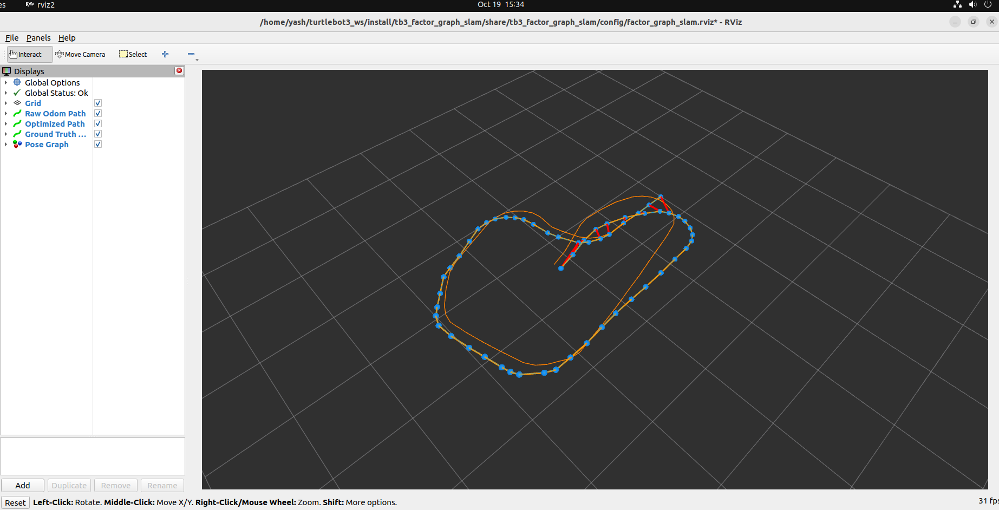

# tb3_factor_graph_slam

Project 2 of the pose-graph/factor-graph SLAM learning track: 2D pose
graph SLAM for TurtleBot3 using ICP scan matching for odometry edges,
radius-based loop closure detection, and GTSAM `Pose2` factor graph
optimization.

This builds directly on project 1 (`tb3_pose_graph_vis`): same keyframe
idea, same relative-pose math (`compose`/`relativeTransform` here are the
same operations as project 1's edge computation). What's new:

- **Scan-matched edges**: instead of trusting raw `/odom` for each edge,
  consecutive keyframes' `/scan` readings are aligned with ICP. A
  converged match becomes the edge measurement (tight noise); otherwise
  it falls back to the raw odometry delta (loose noise).
- **Loop closure detection**: each new keyframe is checked against older
  keyframes (skipping a recent window) for spatial proximity. A nearby
  candidate gets an ICP alignment attempt; a good match becomes a
  loop-closure edge.
- **GTSAM optimization**: a `Pose2` prior anchors node 0 at the first odometry pose,
  `BetweenFactor`s link consecutive and loop-closed nodes, and every
  loop closure triggers a full batch Levenberg-Marquardt re-optimization
  of the graph.
- **Occupancy grid mapping**: each keyframe keeps its raw LiDAR scan, and
  the scans are ray-cast into a log-odds grid from the keyframe poses.
  Two maps are built, one from raw odometry poses and one from optimized
  poses, so you can see directly what the pose graph buys you.

## What to expect

TurtleBot3's simulated `/odom` is essentially ground truth, so on its
own there is no drift for the graph to correct. The launch file
therefore starts `tb3_odom_noise` by default (`use_noisy_odom:=true`),
which republishes `/odom` with synthetic drift on `/odom_noisy`; the SLAM
node reads that topic instead.

Drive the robot around `turtlebot3_world`'s perimeter and back to
(roughly) where you started. You should see, in order:

1. `raw_odom_path` and `optimized_path` slowly diverge as you drive (same
   drift you saw in project 1).
2. The console logs a `Loop closure: node X <-> node Y` message once you
   get back near the start.
3. `optimized_path` visibly snaps toward `gt_path` right at that moment
   — the graph markers will show the whole loop's shape correct itself,
   not just the newest node.
4. `/factor_graph/optimized_drift` should drop noticeably compared to
   `/factor_graph/raw_drift` at that same moment.

5. The **Optimized Map** (left) has crisp, single walls, while the **Raw
   Odometry Map** (right) shows smeared or doubled walls where drift
   accumulated. When a loop closure fires, the optimized map is
   re-rendered from the corrected poses and the walls snap into place.

If you don't complete a real loop, you'll only ever see step 1 — no
loop closure candidate will be within the search radius, which is
expected, not a bug.

## Prerequisites

Everything from project 1's prerequisites, plus two extra libraries
that aren't part of a standard ROS2 install.

### PCL (scan matching)

Usually already present with `ros-humble-desktop`, but confirm:

```bash
sudo apt update
sudo apt install libpcl-dev
```

### GTSAM (factor graph optimization)

GTSAM isn't in the default Ubuntu or ROS repos. The simplest path on
Ubuntu 22.04 (Jammy, matching ROS2 Humble) is the Borglab PPA:

```bash
sudo add-apt-repository ppa:borglab/gtsam-release-4.1
sudo apt update
sudo apt install libgtsam-dev libgtsam-unstable-dev
```

Verify it installed a CMake config `find_package` can locate:

```bash
find / -name "GTSAMConfig.cmake" 2>/dev/null
```

If the PPA isn't available for your Ubuntu version, build from source
instead (slower, but always works):

```bash
git clone https://github.com/borglab/gtsam.git
cd gtsam && mkdir build && cd build
cmake .. -DGTSAM_BUILD_WITH_MARCH_NATIVE=OFF -DCMAKE_BUILD_TYPE=Release
make -j$(nproc)
sudo make install
sudo ldconfig
```

## Build

```bash
cd ~/your_ws
cp -r /path/to/tb3_factor_graph_slam src/
cp -r /path/to/tb3_odom_noise src/        # required by the default launch
colcon build --packages-select tb3_factor_graph_slam tb3_odom_noise
source install/setup.bash
```

If `colcon build` fails with `Could not find a package configuration
file provided by "GTSAM"`, the PPA/source install above didn't finish
correctly — re-check the `GTSAMConfig.cmake` search above before
retrying.

## Run

```bash
export TURTLEBOT3_MODEL=waffle_pi   # match your TB3 model
ros2 launch tb3_factor_graph_slam factor_graph_slam.launch.py
```

Launch arguments:

| Argument | Default | Meaning |
|---|---|---|
| `use_noisy_odom` | `true` | Start `tb3_odom_noise` and feed the SLAM node `/odom_noisy`. Set `false` to use clean `/odom` (the launch file then needs no `tb3_odom_noise` at runtime). |
| `ground_truth_topic` | `/ground_truth/state` | Ground truth odometry used for the drift metrics |

Check the noisy odometry is wired correctly:

```bash
ros2 topic info /odom_noisy --verbose
```

It should show one publisher (`odom_noise_injector_node`) and one
subscriber (`factor_graph_slam_node`). The amount of drift is set by the
`linear_bias_scale` and `angular_bias_per_meter` parameters of the noise
node in the launch file.

Ground truth is optional here — it only feeds the drift-comparison
topics. If you already did project 1's `libgazebo_ros_p3d.so` setup,
it'll be picked up automatically. If not, the SLAM graph, scan matching,
and loop closures all work fine without it; you'll just see
`/factor_graph/raw_drift` and `/factor_graph/optimized_drift` stay
silent (no ground truth to compare against).

Then drive a full loop:

```bash
ros2 run turtlebot3_teleop teleop_keyboard
```

## Topics

| Topic | Type | Meaning |
|---|---|---|
| `/factor_graph/raw_odom_path` | `nav_msgs/Path` | Trajectory straight from `/odom`, never touched by the graph |
| `/factor_graph/optimized_path` | `nav_msgs/Path` | Current best GTSAM estimate for every keyframe |
| `/factor_graph/gt_path` | `nav_msgs/Path` | Ground truth (if available) |
| `/factor_graph/graph_markers` | `visualization_msgs/MarkerArray` | Nodes (blue spheres), odometry edges (orange), loop closures (red) |
| `/factor_graph/optimized_map` | `nav_msgs/OccupancyGrid` | Map ray-cast from the optimized keyframe poses (transient-local QoS) |
| `/factor_graph/raw_map` | `nav_msgs/OccupancyGrid` | Map ray-cast from raw odometry poses, shifted by `raw_map_x_offset` for side-by-side display |
| `/factor_graph/raw_drift` | `std_msgs/Float64` | \|raw_odom − ground_truth\| at the latest keyframe |
| `/factor_graph/optimized_drift` | `std_msgs/Float64` | \|optimized − ground_truth\| at the latest keyframe |
| `/factor_graph/loop_closure_count` | `std_msgs/Int32` | Running total of accepted loop closures |

## Mapping

The map is a function of the keyframe poses and their stored scans, so
the pose graph does the hard part and mapping is only a rendering step.

1. **Store raw scans.** Every keyframe keeps its LiDAR ranges in the
   sensor frame (`StoredScan`), not pre-transformed into the map.
2. **Ray-cast into a log-odds grid** (`OccupancyGridMap`). For each beam,
   Bresenham's line algorithm walks from the sensor cell to the end
   cell. Cells along the way get "more free" (-0.4), and the end cell
   gets "more occupied" (+0.85) if the beam actually hit something.
   Beams with no return (`inf`) only mark free space, `NaN` and
   below-`range_min` readings are skipped, and values are clamped to
   [-5, 5].
3. **Account for the LiDAR mount.** The LiDAR is not at the robot base
   origin, so each scan is placed using `compose(base_pose, lidar_offset)`.
   Defaults are for waffle_pi (-0.064 m in x); burger is -0.032 m.
4. **Update schedule.** A new keyframe is integrated incrementally. After
   every loop closure the optimized map is **reset and re-rendered from
   all keyframes at their new poses**, because every pose may have moved.
   The raw map never needs this, since raw odometry poses never change.
5. **Publish** as `nav_msgs/OccupancyGrid` in the `odom` frame (unknown
   cells -1, known cells 0-100) with transient-local QoS, so RViz shows
   the latest map even if it connects late.

Scope: this is mapping with poses from the graph, not a tightly coupled
SLAM system. There is no scan-to-map matching, and the map is only as
good as the optimized poses. Rebuilding on every loop closure is cheap at
this scale (hundreds of keyframes) but would not scale to a large
environment.

## RViz setup

The launch file opens RViz with `config/factor_graph_slam.rviz`, which
already contains these displays (raw odom orange, optimized blue,
ground truth white, graph markers, and the two maps). The raw-odometry
map is drawn `raw_map_x_offset` metres to the right of the optimized map
(display only; the paths are not shifted). Map displays need Durability
Policy set to Transient Local, which the config already does. The optimized path is drawn in a
similar blue to the node spheres, so it can be hard to see underneath
them. If a display shows an error, delete it and re-add it by topic
(Fixed Frame: `odom`):

1. `/factor_graph/raw_odom_path` — Path, color it orange
2. `/factor_graph/optimized_path` — Path, color it blue/green so it's
   visually distinct
3. `/factor_graph/gt_path` — Path, color it black or white
4. `/factor_graph/graph_markers` — MarkerArray (loop closure edges render
   in red automatically)

Watching `optimized_path` snap toward `gt_path` at the exact moment a
red loop-closure edge appears in the markers is the whole point of this
project — it's optimization actually doing something, not just a graph
sitting there.


*Raw odometry (orange) vs. GTSAM-optimized pose graph (blue) with ICP loop closures (red).*

## Tuning

| Parameter | Default | Effect |
|---|---|---|
| `keyframe_linear_threshold` / `keyframe_angular_threshold` | 0.3 m / 0.3 rad | Denser graph = better scan overlap for ICP, more compute |
| `loop_closure_search_radius` | 1.0 m | Larger = more loop closure attempts, more false-positive risk |
| `loop_closure_min_index_gap` | 20 | Prevents "closing a loop" with a keyframe from 2 seconds ago |
| `loop_closure_fitness_threshold` | 0.05 | Lower = stricter acceptance of loop closure ICP matches |
| `icp_fitness_threshold` | 0.08 | Lower = stricter acceptance of odometry-edge ICP matches |

Mapping parameters (set in the launch file):

| Parameter | Default | Effect |
|---|---|---|
| `build_map` | `true` | Set `false` to skip mapping entirely |
| `map_resolution` | 0.05 m | Cell size; smaller = sharper walls, larger messages |
| `map_width` / `map_height` | 12 m | Grid extent; must cover everywhere the robot (including drifted raw poses) can go, since anything outside is ignored |
| `map_origin_x` / `map_origin_y` | -6 m | World position of the grid's corner. The default window is centred near the world origin |
| `lidar_offset_x/y/yaw` | -0.064 / 0 / 0 | LiDAR pose relative to the base (waffle_pi) |
| `raw_map_x_offset` | 13.0 (launch arg) | Display shift of the raw map; `0.0` overlays the two maps |

If loop closures never fire even after a clean loop, try raising
`loop_closure_search_radius` slightly (odometry drift may have grown
larger than 1.0 m by the time you return) or lowering
`keyframe_linear_threshold` for denser scan overlap.

If you get *false* loop closures (edges connecting places that aren't
actually the same location), tighten `loop_closure_fitness_threshold`.

The fitness thresholds are PCL's mean *squared* point distance, so 0.05
allows roughly 0.22 m RMS alignment error, which is lenient. If the graph
drifts away from ground truth, or the red loop-closure edges are long
(close to the search radius) instead of short, try
`loop_closure_fitness_threshold: 0.01` and `icp_fitness_threshold: 0.02`.
Poor sequential matches then fall back to odometry, and weak loop
closures are rejected.

## Troubleshooting

- **`colcon build` can't find GTSAM**: see the GTSAM prerequisite section
  above — this is almost always the PPA not being available for your
  Ubuntu release, or a stale `sudo apt update` before installing.
- **ICP never converges (constant "did not converge" warnings)**: check
  `ros2 topic hz /scan` is publishing at a reasonable rate, and that
  `keyframe_linear_threshold` isn't so large that consecutive scans have
  little overlap.
- **No loop closures despite a clean loop**: log the actual distances —
  temporarily lower `RCLCPP_INFO` verbosity or add a print of `best_dist`
  in `tryLoopClosure` to see how close the search is coming.
- **`raw_odom_path` and `gt_path` lie exactly on top of each other**:
  the noise injector isn't feeding the SLAM node. Run
  `ros2 topic info /odom_noisy --verbose` and confirm one publisher and
  one subscriber. If the launch fails with a package-not-found error for
  `tb3_odom_noise`, build and source it (see Build), or launch with
  `use_noisy_odom:=false`.
- **Loop-closure edges are long, or `optimized_drift` is larger than
  expected**: the ICP acceptance thresholds are probably too loose; see
  the note under Tuning. Also check the console for the `fitness=` value
  logged with each closure.
- **No maps appear in RViz**: confirm `ros2 topic hz /factor_graph/optimized_map`
  shows messages, then check the Map display's Durability Policy is
  Transient Local and its topic matches. Maps only appear after the first
  keyframe, so drive the robot.
- **Map is shifted or cut off**: the robot left the grid. Increase
  `map_width`/`map_height` or move `map_origin_x/y`. The raw map shifted
  right of the optimized one is intentional (`raw_map_x_offset`).
- **Walls are doubled or blurry in the optimized map**: usually a
  frame problem. Check `lidar_offset_x` matches your TB3 model, and
  that scans are paired with their own keyframe's pose, not the latest
  odometry.
- **Streaks across the map**: beams with `inf`/`NaN` ranges must be
  handled as described under Mapping; if you modified
  `integrateScan`, check that case first.
- **The graph appears offset from the other paths**: node 0 must be
  anchored at the first odometry pose (the current code does this). If
  you are on an older copy that pinned node 0 at `(0, 0, 0)`, update
  `addFirstKeyframe` in `factor_graph_slam_node.cpp`, otherwise
  `optimized_drift` will include the robot's spawn offset.

  ## Video Demonstration
  [](https://www.youtube.com/watch?v=ktDEgRJt4u4)